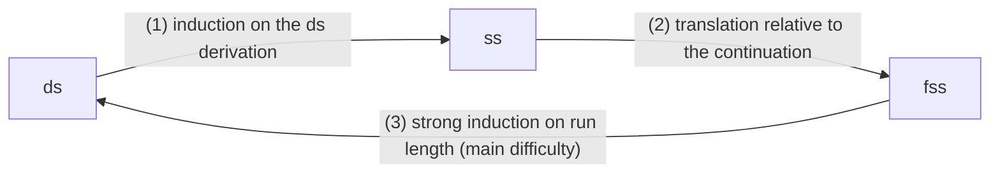
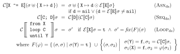
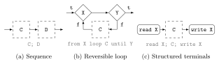
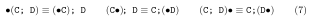
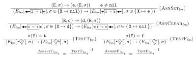
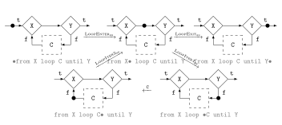
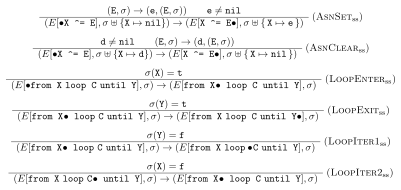

# Reading the proof of Theorem 3 (semantic equivalence)

[日本語版](theorem3-proof_ja.md)

This note walks through the proof outline of Theorem 3 of the companion
letter, the equivalence of the denotational (ds), small-step (ss) and
finer-grained flowchart (fss) semantics of R-CORE. Each step is matched with
the figures of the source paper [MaYo26] and with the identifiers in
[`proofs.v`](../proofs.v) that carry it out. Identifiers are given by name;
search the file for them.

## The paragraph

The letter outlines the proof as follows ([1] of the letter is [MaYo26]):

> The proof closes the cycle ds → ss → fss → ds. The first implication is by
> induction on the ds derivation. For the second, a controlled command is
> translated relative to the flowchart of its continuation; an assignment or
> loop step then becomes one fss step and a token movement across `;` becomes
> none. The main difficulty is the third implication, which recovers the
> structure of `C` from an fss run. We use strong induction on the run
> length, with a structural induction for the sequencing case. A run for
> `C1; C2` is factored at the entry of the flowchart for `C2`. This entry
> cannot be revisited: the first step from an entry strictly decreases the
> size of the outer continuation, and subsequent steps never increase it.
> Loop runs are decomposed into body traversals and returns to the
> assertion, yielding shorter runs to which the induction hypothesis
> applies. The program-level statement of [1] follows as a corollary for the
> amended semantics.

## What is proved

For a command `C`, stores σ and σ′, and `F` the flowchart of `C`, the
following are equivalent:

1. **ds**: 𝒞⟦C⟧σ = σ′.
2. **ss**: (•C, σ) →\* (C•, σ′), the control token moves from before `C` to
   after it.
3. **fss**: (•F, σ) →\* (F•, σ′), the token traverses `F` from its entry to
   its exit.

Six implications relate three statements, but a cycle of three suffices:
following the arrows connects any two of them.



## (1) ds ⇒ ss

A ds judgement 𝒞⟦C⟧σ = σ′ is witnessed by a derivation built from the three
rules of Fig. 2(c). The proof follows that derivation and builds the ss run
(•C, σ) →\* (C•, σ′) rule by rule.



*Adapted from [MaYo26], Fig. 2(c). The rules Asn<sub>ds</sub>,
Seq<sub>ds</sub> and Loop<sub>ds</sub>.*

- **Assignment** `X ^= E`: one ss step moves the token from before to after
  the assignment (the single amended rule `S_Asn`).
- **Sequence** `C; D`: the induction hypothesis gives runs for `C` and for
  `D`. The run for `C` is replayed inside the context `□; D`, the token
  crosses `;` by Eq. (7), and the run for `D` follows.
- **Loop**: Fig. 2(c) defines the loop by a least fixed point fix(F). The
  development states it instead as an inductive relation `loop_sem` with
  two rules, exit (`L_Base`) and one more iteration (`L_Rec`), and inducts on
  `exec_ds` and `loop_sem` together. The run is LoopEnter<sub>ss</sub>,
  then repeatedly LoopIter1<sub>ss</sub>, the body, LoopIter2<sub>ss</sub>,
  and finally LoopExit<sub>ss</sub>.

Identifier: `ds_implies_ss`.

## (2) ss ⇒ fss

An ss configuration is a command carrying the token; an fss configuration is
a position in a flowchart. The key is to translate a command not on its own
but together with **the flowchart that follows it**, its continuation `rest`:



*Adapted from [MaYo26], Fig. 4.*

```coq
Fixpoint translate (c : cmd) (rest : flowchart) : flowchart :=
  match c with
  | Cass x e        => F_step x e rest
  | Cseq c1 c2      => translate c1 (translate c2 rest)
  | Cloop x cb y    => F_loop x (translate cb F_nil) y rest
  end.
```

Token positions are translated against the same `rest` (`translate_ctrl`):
`•C` goes to the entry of `translate C rest`, and `C•` to the entry of
`rest`. Counting fss steps per ss rule then gives:

| ss step (Fig. 9(b)) | fss steps | fss rule (Fig. 11(a)) |
|---|:-:|---|
| assignment, `S_Asn` | 1 | `FS_Asn` (AsnSet and AsnClear merged) |
| LoopEnter<sub>ss</sub> | 1 | AssertT<sub>fss</sub> (`FS_AssertT`) |
| LoopExit<sub>ss</sub> | 1 | TestT<sub>fss</sub> (`FS_TestT`) |
| LoopIter1<sub>ss</sub> | 1 | TestF<sub>fss</sub> (`FS_TestF`) |
| LoopIter2<sub>ss</sub> | 1 | AssertF<sub>fss</sub> (`FS_AssertF`) |
| crossing `;` by Eq. (7) | **0** | none: both sides translate to the same position |



*Adapted from [MaYo26], Eq. (7). The development orients the three
equations as the steps `S_Seq_Enter`, `S_Seq_Mid` and `S_Seq_Exit`.*

**Why zero.** Translate `(C1•); C2` and `C1; (•C2)` against the same
`rest`. The first is the exit of `C1` under the continuation
`translate C2 rest`, that is, the entry of `translate C2 rest`. The second
is the entry of `translate C2 rest` as well. It is one point of the
flowchart, so fss does not move.



*Adapted from [MaYo26], Fig. 11(a).*

Since one ss step becomes zero or one fss step, there is no lock-step
correspondence. Each ss step is mapped to a finite fss run
(`ss_step_implies_fss_steps`), steps inside a loop body are lifted into the
loop (`fsteps_lift_loop`), and the runs are joined by induction on the ss
run (`ss_implies_fss`).

## (3) fss ⇒ ds (the main difficulty)

An fss run is a **flat** sequence of node crossings. Nothing in it marks
where `C1` ends and `C2` begins, or how many times a loop went round. To
build a ds derivation, the run has to be cut along the nested structure of
`C`.

**Generalized statement** (`fss_complete_to_pre`). For every `n`, `C` and
`R`: if an fss run of `n` steps goes from the entry of `translate C R` to the
entry of `R`, turning σ into σ′, then 𝒞⟦C⟧σ = σ′. The continuation `R` is
left free so that the statement applies to a subcommand sitting in the
middle of a larger flowchart.

**Why induction on length.** Structural induction on `C` alone gets stuck at
loops: after one traversal of the body, the rest of the run is a run of the
*same* loop, which is not structurally smaller. It is shorter, though, so
the proof uses strong induction on `n` (it may assume the claim for every
run shorter than `n`).

**Cases.**

- **Assignment.** The first step reaches the entry of `R`. The rest of the
  run goes from the entry of `R` to the entry of `R`, so it is empty by the
  no-revisit property below (`fnsteps_pre_no_cycle`). What remains is the
  ds assignment rule.
- **Sequence `C1; C2`.** The flowchart is `translate C1 (translate C2 R)`.
  The run is cut where it first reaches **the entry of `C2`**, the entry of
  `translate C2 R` (`fss_seq_factor`). The prefix is a run of `C1` under
  the continuation `translate C2 R`, the suffix a run of `C2` under `R`, and
  both are shorter, so the hypothesis applies. When `C1` is itself a
  sequence, `(C1a; C1b); C2` is reassociated to `C1a; (C1b; C2)` and the
  lemma recurses on the structure of `C1`; this is the structural induction
  "for the sequencing case".
- **Loop.** After the assertion is passed, the run is split along the
  transitions of Fig. 8 into repetitions of "enter the body at the test,
  traverse the body from entry to exit, return to the assertion", followed
  by a final "leave at the test". Each body traversal is shorter than the
  whole; the decomposition lemma returns that length `m < n` explicitly
  (`fnsteps_in_loop_to_pre`), so the hypothesis yields ds for the body.



*Adapted from [MaYo26], Fig. 8. In (3), runs are cut into the units
LoopIter1 (enter the body), a body traversal, and LoopIter2 (return to the
assertion).*

## Why the entry is not revisited

The sequence case cuts at the *first* arrival at the entry of `C2`. If a run
could pass that entry several times, the cut would be ambiguous. The
sentence "This entry cannot be revisited" rules this out.

Each position has an **outer continuation** (`outer_rest`): at an entry `•F`
it is `F` itself; inside a loop it is the part after that loop. Its size
(`flow_size`) counts the nodes in it, loop bodies included.

- **The first step from an entry strictly decreases it**
  (`fstep_pre_strict`). `F` starts either with an assignment node, which
  leads to `•F'`, or with a loop, which moves the outer continuation to
  `F'`. Either way it gets strictly smaller than `F`.
- **Later steps never increase it** (`fnsteps_outer_rest_sub`). Inside a loop
  the outer continuation does not change, and leaving the loop lands on its
  entry.

So once a run leaves `•F`, the size stays below that of `F` and the run never
returns to `•F` (`fnsteps_pre_no_cycle`).

**Example.** `C1` is an assignment, `C2` a loop whose body is one
assignment, and `R` is empty.

| step | position | rule taken | size of outer continuation |
|:-:|---|---|:-:|
| 0 | entry of `C1; C2` | | 3 |
| 1 | **entry of `C2`** | assignment | **2** |
| 2 | between `X` and `Y` | AssertT | 0 |
| 3 | before the body | TestF | 0 |
| 4 | after the body | assignment (inside the loop) | 0 |
| 5 | between `X` and `Y` | AssertF | 0 |
| 6 | entry of `R` | TestT | 0 |

The size 2 occurs only at step 1, so the entry of `C2` is passed once.

## The program-level corollary

Theorem 1 of [MaYo26] is stated for a program `read X; C; write X`. It adds
one step to read the input and one to write the output around Theorem 3
for `C`, and follows from it (`prog_traversal_data`). This holds for the
**amended** semantics. With the assignment rules as stated in [MaYo26],
ss is stuck on well-formed assignments such as `X0 ^= nil` where ds and fss
move, and the equivalence fails (see [gap-witness-table.md](gap-witness-table.md)).



*Adapted from [MaYo26], Fig. 9(b). The premises e ≠ nil and d ≠ nil of
AsnSet<sub>ss</sub> and AsnClear<sub>ss</sub> are where the defect lies.
The development merges the two rules into `S_Asn`, which has neither.*

## Two readings of fss

Steps (2) and (3) are proved with positions represented by the *remaining*
flowchart (`fstep`). Theorem 3 of the letter, like [MaYo26], reads fss as a
token moving over a *fixed* flowchart `F` (`pstep`). The two agree on runs
from entry to exit (`ds_iff_pfss`), which transfers the result;
`semantic_equivalence_p` is Theorem 3 in that reading.

## Identifiers

| Part of the outline | Identifier in `proofs.v` |
|---|---|
| (1) ds ⇒ ss | `ds_implies_ss` |
| (2) translation relative to the continuation | `translate`, `translate_ctrl` |
| (2) one ss step becomes finitely many fss steps | `ss_step_implies_fss_steps` |
| (2) ss ⇒ fss | `ss_implies_fss` |
| (3) outer continuation and its size | `outer_rest`, `flow_size` |
| (3) strict first step, no increase afterwards | `fstep_pre_strict`, `fnsteps_outer_rest_sub` |
| (3) an entry is not revisited | `fnsteps_pre_no_cycle` |
| (3) loop runs decomposed, returning `m < n` | `fnsteps_in_loop_to_pre` |
| (3) a sequence run cut at the entry of `C2` | `fss_seq_factor` |
| (3) the generalized statement | `fss_complete_to_pre` |
| fixed-flowchart reading | `ds_iff_pfss` |
| Theorem 3 | `semantic_equivalence_p` |
| program-level corollary | `prog_traversal_data` |

## Glossary

- **Induction on a derivation**: proving a property of every judgement by
  showing that each inference rule preserves it; derivations are finite
  trees, so this covers all of them.
- **Strong induction**: proving the claim for `n` assuming it for every
  number below `n`. Here `n` is the length of a run.
- **Structural induction**: proving a claim for a command from the claim for
  its subcommands (assignment, sequence, loop).
- **Controlled command**: a command with the token • written into it; an ss
  configuration pairs one with a store.
- **Continuation**: the rest of the flowchart that runs after a given part.
- **Outer continuation**: the part that the token reaches next outside the
  innermost loop around it.
- **Entry**: the position just before the first node of a flowchart,
  written `•F`.

## Reference

[MaYo26] T. Makino and T. Yokoyama, "Small-step semantics with meta-level
reversibility for a reversible core language," Reversible Computation
(RC 2026), LNCS vol. 16626, pp. 201–218, Springer, 2026.
DOI: [10.1007/978-3-032-30839-9_12](https://doi.org/10.1007/978-3-032-30839-9_12)

The figures in [`fig/`](fig/) are redrawn by the authors from their own LaTeX
source of [MaYo26] (sources and build script in [`fig/src/`](fig/src/)).
They are adapted from that paper and are not covered by the MIT license of
this repository.
