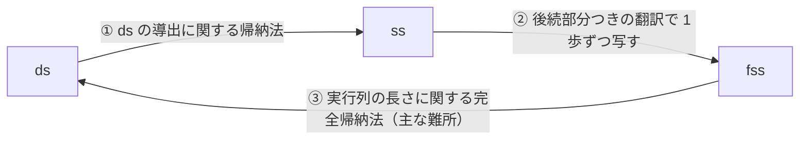

# 定理3（意味論の同値性）の証明を読む

[English version](theorem3-proof.md)

この文書は，姉妹編のレターの定理3，すなわち R-CORE の表示的意味論（ds），小ステップ意味論（ss），フローチャート上の細粒度意味論（fss）の同値性について，その証明概要を読み解く．各段階を，原著 [MaYo26] の図と，それを実行している [`proofs.v`](../proofs.v) の識別子に対応づける．識別子は名前で示すので，ファイル内を検索してほしい．

## 段落と訳

レターは証明の概要を次のように述べる（レターの [1] は [MaYo26] である）．

> The proof closes the cycle ds → ss → fss → ds. The first implication is by
> induction on the ds derivation. For the second, a controlled command is
> translated relative to the flowchart of its continuation; an assignment or
> loop step then becomes one fss step and a token movement across `;` becomes
> none. The main difficulty is the third implication, which recovers the
> structure of `C` from an fss run. We use strong induction on the run
> length, with a structural induction for the sequencing case. A run for
> `C1; C2` is factored at the entry of the flowchart for `C2`. This entry
> cannot be revisited: the first step from an entry strictly decreases the
> size of the outer continuation, and subsequent steps never increase it.
> Loop runs are decomposed into body traversals and returns to the
> assertion, yielding shorter runs to which the induction hypothesis
> applies. The program-level statement of [1] follows as a corollary for the
> amended semantics.

1 文ずつの意味は次のとおりである．

| 英文 | 意味 |
|---|---|
| The proof closes the cycle ds → ss → fss → ds. | 証明は ds ⇒ ss ⇒ fss ⇒ ds という一巡の含意を示して閉じる． |
| The first implication is by induction on the ds derivation. | 含意①（ds ⇒ ss）は，ds の導出に関する帰納法で示す． |
| For the second, a controlled command is translated relative to the flowchart of its continuation; an assignment or loop step then becomes one fss step and a token movement across `;` becomes none. | 含意②（ss ⇒ fss）では，制御付きコマンドを「そのあとに続くフローチャート」を基準にして翻訳する．すると代入とループの ss の 1 歩は fss の 1 歩に，「;」をまたぐトークンの移動は fss の 0 歩になる． |
| The main difficulty is the third implication, which recovers the structure of `C` from an fss run. | 主な難所は含意③（fss ⇒ ds）である．fss の実行列は平らな歩みの列なので，そこからコマンド `C` の入れ子構造を復元しなければならない． |
| We use strong induction on the run length, with a structural induction for the sequencing case. | 実行列の長さに関する完全帰納法を使い，逐次合成の場合にはさらに構造帰納法を重ねる． |
| A run for `C1; C2` is factored at the entry of the flowchart for `C2`. | `C1; C2` の実行列は，`C2` のフローチャートの入口で前後二つに分ける． |
| This entry cannot be revisited: the first step from an entry strictly decreases the size of the outer continuation, and subsequent steps never increase it. | この入口を二度通ることはない．入口からの最初の 1 歩で「外側の後続部分」の大きさが真に減り，その後の歩みでは決して増えないからである． |
| Loop runs are decomposed into body traversals and returns to the assertion, yielding shorter runs to which the induction hypothesis applies. | ループの実行列は「本体を 1 回通り抜ける部分」と「アサーションへ戻る 1 歩」に分ける．分けた各部分は元の列より短いので，帰納法の仮定が使える． |
| The program-level statement of [1] follows as a corollary for the amended semantics. | 原著のプログラム単位の主張（`read X; C; write X` についての Theorem 1）は，修正後の意味論について系として従う． |

## 何を示すのか

コマンド `C`，記憶 σ, σ′，`C` を翻訳したフローチャート `F` について，次の三つが同値である．

1. **ds**．𝒞⟦C⟧σ = σ′．
2. **ss**．(•C, σ) →\* (C•, σ′)．トークンが `C` の前から後ろへ有限回の遷移で移る．
3. **fss**．(•F, σ) →\* (F•, σ′)．トークンが `F` を入口から出口まで通り抜ける．

三つの同値には向きの違う含意が 6 本要るように見えるが，一巡する 3 本を示せば，矢印をたどってどの二つの間も行き来できるので 3 本で足りる．



## 含意① ds ⇒ ss

ds の「C を σ に適用すると σ′」という主張は，図 2(c) の 3 規則を組み合わせた導出（証明の木）で裏づけられる．その木の形に沿って帰納法を回し，ss の遷移列 (•C, σ) →\* (C•, σ′) を規則ごとに組み立てる．


*[MaYo26] の Fig. 2(c) を描き直したもの．Asn<sub>ds</sub>，Seq<sub>ds</sub>，Loop<sub>ds</sub> の 3 規則．*

- **代入** `X ^= E`．ss の代入規則 1 歩でトークンが前から後ろへ移る（修正後の 1 本の規則 `S_Asn`）．
- **逐次合成** `C; D`．帰納法の仮定で `C` と `D` の遷移列が手に入る．`C` の列を文脈「□; D」の中で走らせ，式 (7) で「;」をまたいでトークンを渡し，`D` の列をつなぐ．
- **ループ**．図 2(c) では最小不動点 fix(F) で定義されている．形式化ではこれを「出口で終わる」（`L_Base`）と「本体を 1 回実行して戻る」（`L_Rec`）の 2 規則からなる帰納的な関係 `loop_sem` に書き直し，`exec_ds` と同時に帰納法を回す．遷移列は LoopEnter<sub>ss</sub> のあと「LoopIter1<sub>ss</sub>，本体の列，LoopIter2<sub>ss</sub>」を繰り返し，最後に LoopExit<sub>ss</sub> で抜ける．

識別子は `ds_implies_ss`．

## 含意② ss ⇒ fss

ss の状態は「トークンの入ったコマンド」，fss の状態は「フローチャート上の位置」である．鍵は，コマンドを単独で翻訳するのではなく，**そのあとに続くフローチャート**（後続部分 `rest`）を引数に持たせて翻訳することにある．


*[MaYo26] の Fig. 4 を描き直したもの．*

```coq
Fixpoint translate (c : cmd) (rest : flowchart) : flowchart :=
  match c with
  | Cass x e        => F_step x e rest
  | Cseq c1 c2      => translate c1 (translate c2 rest)
  | Cloop x cb y    => F_loop x (translate cb F_nil) y rest
  end.
```

トークンの位置も同じ `rest` を基準に写す（`translate_ctrl`）．`•C` は `translate C rest` の入口へ，`C•` は `rest` の入口へ写る．この写し方で ss の各規則が fss の何歩に当たるかを数えると，次のようになる．

| ss の遷移（図 9(b)） | fss の歩数 | fss の規則（図 11(a)） |
|---|:-:|---|
| 代入 `S_Asn` | 1 | `FS_Asn`（AsnSet と AsnClear をまとめたもの） |
| LoopEnter<sub>ss</sub>（ループに入る） | 1 | AssertT<sub>fss</sub>（`FS_AssertT`） |
| LoopExit<sub>ss</sub>（ループを出る） | 1 | TestT<sub>fss</sub>（`FS_TestT`） |
| LoopIter1<sub>ss</sub>（本体に入る） | 1 | TestF<sub>fss</sub>（`FS_TestF`） |
| LoopIter2<sub>ss</sub>（アサーションへ戻る） | 1 | AssertF<sub>fss</sub>（`FS_AssertF`） |
| 式 (7) による「;」をまたぐ移動 | **0** | なし（両辺が同じ位置に写る） |


*[MaYo26] の式 (7) を描き直したもの．形式化では 3 本の等式を向きのある遷移 `S_Seq_Enter`，`S_Seq_Mid`，`S_Seq_Exit` として表す．*

**0 歩になる理由．** `(C1•); C2` と `C1; (•C2)` を同じ `rest` で写すと，前者は「後続部分 `translate C2 rest` のもとでの `C1` の出口」，つまり `translate C2 rest` の入口になり，後者も `translate C2 rest` の入口になる．フローチャートの上では同じ点なので，fss は 1 歩も動かない．


*[MaYo26] の Fig. 11(a) を描き直したもの．*

ss の 1 歩が fss の 0 歩か 1 歩に対応する，つまり歩数が一対一にそろわないので，1 歩ずつ対応させる型の議論はそのままは使えない．そこで ss の 1 歩ごとに fss の有限個の歩みを作り（`ss_step_implies_fss_steps`），ループ本体の中の歩みはループという文脈へ持ち上げ（`fsteps_lift_loop`），それらを ss の遷移列についての帰納法でつなぐ（`ss_implies_fss`）．

## 含意③ fss ⇒ ds（主な難所）

fss の実行列は，フローチャートの節点を 1 つずつ渡っていく**平らな列**である．どこまでが `C1` の分でどこからが `C2` の分か，ループを何回まわったかは，列そのものには書かれていない．ds の導出を作るには，この列を `C` の入れ子構造に沿って切り分けなければならない．

**一般化した主張**（`fss_complete_to_pre`）．任意の `n`，`C`，`R` について，`translate C R` の入口から `R` の入口まで `n` 歩で行き，σ を σ′ に変える fss の列があれば，𝒞⟦C⟧σ = σ′ である．後続部分 `R` を自由に動かせる形にしておくのは，大きなフローチャートの途中にある部分コマンドにも主張を使えるようにするためである．

**なぜ長さで帰納法をするのか．** `C` の構造だけで帰納法を回すとループで行き詰まる．本体を 1 回まわったあとの残りの列は**同じループ**の実行列であり，構造としては小さくなっていない．一方で列の長さは確実に短くなっている．そこで「長さが `n` 未満の列については主張が成り立つ」と仮定してよい完全帰納法を使う．

**場合分け．**

- **代入．** 最初の 1 歩で `R` の入口に着く．残りの列は `R` の入口から `R` の入口への列だが，下で述べる「入口を二度通らない」性質（`fnsteps_pre_no_cycle`）から長さ 0 である．よって ds の代入規則そのものになる．
- **逐次合成 `C1; C2`．** フローチャートは `translate C1 (translate C2 R)` である．列が初めて **`C2` の入口**（`translate C2 R` の入口）に着いた所で前後に切る（`fss_seq_factor`）．前半は「後続部分 `translate C2 R` のもとでの `C1` の列」，後半は「後続部分 `R` のもとでの `C2` の列」で，どちらも元より短いので仮定が使える．`C1` 自身が逐次合成のときは `(C1a; C1b); C2` を `C1a; (C1b; C2)` と組み替えて `C1` の構造について再帰する．本文の「逐次合成の場合に構造帰納法を重ねる」はこの部分を指す．
- **ループ．** アサーションを通ってループに入ったあとの列を，図 8 の遷移に沿って「テストで本体へ入る，本体を入口から出口まで通り抜ける，アサーションへ戻る」の繰り返しと，最後の「テストで外へ出る」に分ける．本体を通り抜ける各部分は元より短い．分解の補題はその長さ `m < n` を明示的に返す（`fnsteps_in_loop_to_pre`）ので，仮定から本体の ds が得られる．


*[MaYo26] の Fig. 8 を描き直したもの．含意③では，列をこの図の「本体へ入る（LoopIter1），本体を通り抜ける，アサーションへ戻る（LoopIter2）」の単位で切り出す．*

## 入口を二度通らない理由

逐次合成の場合の切り方は「`C2` の入口に**初めて**着いた所」である．もし列が `C2` の入口を何度も通るなら，どこで切るべきか決まらない．本文の「This entry cannot be revisited」はこれが起こらないことを述べている．

各位置に**外側の後続部分**（`outer_rest`）を割り当てる．入口 `•F` ではそれは `F` 自身，ループの内側ではそのループのあとに続く部分である．大きさ（`flow_size`）はそこに含まれる節点の数で測る（ループは本体の節点も数える）．

- **入口からの最初の 1 歩は真に減らす**（`fstep_pre_strict`）．`F` は「代入の節点」か「ループ」で始まる．代入を渡れば `•F'` に，ループに入れば外側の後続部分が `F'` に移る．どちらも `F` より真に小さい．
- **その後の歩みは増やさない**（`fnsteps_outer_rest_sub`）．ループの内側で動く間，外側の後続部分は変わらない．ループを出ると，その後続部分の入口に出るだけである．

したがって一度 `•F` を離れると，外側の後続部分は `F` より小さいまま戻らず，`•F` に再び着くことはない（`fnsteps_pre_no_cycle`）．

**数値例．** `C1` を代入，`C2` を本体が代入 1 つのループ，`R` を空とする．

| 歩 | 位置 | 使った規則 | 外側の後続部分の大きさ |
|:-:|---|---|:-:|
| 0 | `C1; C2` の入口 | | 3 |
| 1 | **`C2` の入口** | 代入 | **2** |
| 2 | `X` と `Y` の間 | AssertT | 0 |
| 3 | 本体の前 | TestF | 0 |
| 4 | 本体の後 | 代入（ループの内側） | 0 |
| 5 | `X` と `Y` の間 | AssertF | 0 |
| 6 | `R` の入口 | TestT | 0 |

大きさ 2 は 1 歩目にしか現れないので，`C2` の入口を通るのは 1 回だけである．

## プログラム単位の系

[MaYo26] の Theorem 1 はプログラム `read X; C; write X` について述べている．これは `C` についての定理3に，入力を読む 1 歩と出力を書く 1 歩を前後に足したものなので，定理3から従う（`prog_traversal_data`）．ただし**修正後の意味論について**である．[MaYo26] の代入規則のままでは，`X0 ^= nil` のような well-formed な代入で ds と fss は進むのに ss だけが止まり，同値性は成り立たない（[gap-witness-table.md](gap-witness-table.md) を参照）．


*[MaYo26] の Fig. 9(b) を描き直したもの．AsnSet<sub>ss</sub> と AsnClear<sub>ss</sub> の前提 e ≠ nil，d ≠ nil が欠陥の箇所である．形式化ではこの 2 規則を，どちらの前提も持たない 1 規則 `S_Asn` にまとめた．*

## fss の二つの読み方

含意②③は，fss の位置を「残りのフローチャート」で表す形（`fstep`）で証明している．レターの定理3は，[MaYo26] と同じく「固定したフローチャート `F` の上をトークンが動く」読み方（`pstep`）で述べている．入口から出口までの実行列については両者が一致することを示して（`ds_iff_pfss`）結論を移している．その読み方での定理3が `semantic_equivalence_p` である．

## 識別子との対応

| 段落の該当箇所 | `proofs.v` の識別子 |
|---|---|
| ① ds ⇒ ss | `ds_implies_ss` |
| ② 後続部分つきの翻訳 | `translate`，`translate_ctrl` |
| ② ss の 1 歩を fss の有限歩に | `ss_step_implies_fss_steps` |
| ② ss ⇒ fss | `ss_implies_fss` |
| ③ 外側の後続部分とその大きさ | `outer_rest`，`flow_size` |
| ③ 最初の 1 歩は真に減らし，以後は増やさない | `fstep_pre_strict`，`fnsteps_outer_rest_sub` |
| ③ 入口を二度通らない | `fnsteps_pre_no_cycle` |
| ③ ループの列の分解（`m < n` を返す） | `fnsteps_in_loop_to_pre` |
| ③ 逐次合成の列を `C2` の入口で分ける | `fss_seq_factor` |
| ③ 一般化した主張 | `fss_complete_to_pre` |
| 固定フローチャートの読み方への移送 | `ds_iff_pfss` |
| 定理3 | `semantic_equivalence_p` |
| プログラム単位の系 | `prog_traversal_data` |

## 用語

- **導出に関する帰納法**．規則から組み立てた証明の木について，各規則が性質を保つことを示す帰納法．木は有限なので全体に及ぶ．
- **完全帰納法**．「`n` 未満のすべてについて成り立つ」と仮定して `n` について示す帰納法（強い帰納法とも呼ぶ）．ここでは `n` は実行列の長さ．
- **構造帰納法**．コマンドの組み立て方（代入，逐次合成，ループ）に沿って，部分コマンドについての仮定から全体を示す帰納法．
- **制御付きコマンド**．トークン • の位置を書き込んだコマンド．ss の状態はこれと記憶の組．
- **後続部分**（continuation）．ある部分のあとに続いて実行されるフローチャートの残り．
- **外側の後続部分**（outer continuation）．トークンがループの内側にいても，そのループの外で次に着く残りの部分．
- **入口**．フローチャートの最初の節点の直前の位置．`•F` と書く．

## 参考文献

[MaYo26] T. Makino and T. Yokoyama, "Small-step semantics with meta-level reversibility for a reversible core language," Reversible Computation (RC 2026), LNCS vol. 16626, pp. 201–218, Springer, 2026.
DOI: [10.1007/978-3-032-30839-9_12](https://doi.org/10.1007/978-3-032-30839-9_12)

[`fig/`](fig/) の図は，著者が [MaYo26] の自身の LaTeX 原稿から描き直したものである（原稿とビルド手順は [`fig/src/`](fig/src/)）．同論文からの翻案であり，このリポジトリの MIT ライセンスの対象外である．
